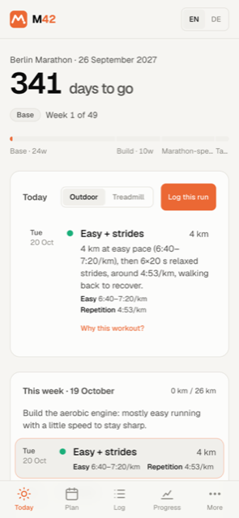
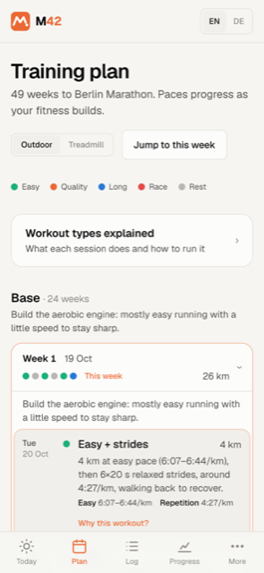
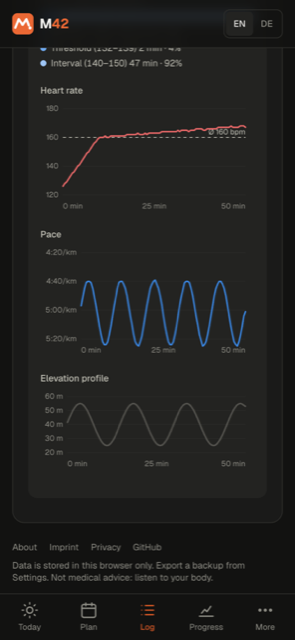
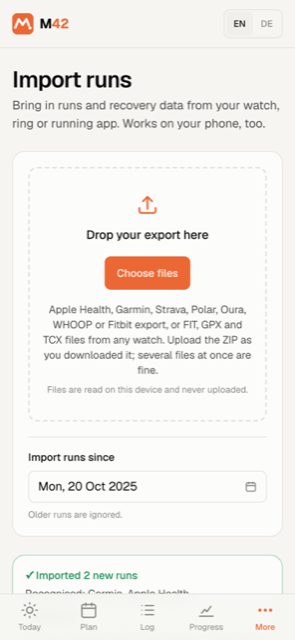

# M42

**A free marathon training coach that keeps your data on your device.**

M42 builds a periodised plan to race day and gives you training paces that match your fitness. It reads your runs from Apple Health, Garmin, Strava, Polar, Oura, WHOOP, Fitbit or any watch's FIT/GPX/TCX files.

There are no accounts, no database and no analytics. Your plan, runs and health data live in your browser, and exports are parsed on your device. Nothing is uploaded.

The name is the distance (42.195 km). The logo is an "M" drawn as a course profile: two climbs and the finish.

**→ Use it at [m42.rinkleff.dev](https://m42.rinkleff.dev)** · English and German · works offline as an app on your phone

<p>
  
  
  
  
</p>

## Contents

- [Features](#features)
- [Using M42 on the website](#using-m42-on-the-website)
- [Importing your data](#importing-your-data)
- [Running it locally](#running-it-locally)
- [Deploying your own copy](#deploying-your-own-copy)
- [Privacy and security](#privacy-and-security)
- [How it works: methodology and sources](#how-it-works-methodology-and-sources)
- [Tests](#tests)
- [Project structure](#project-structure)
- [Optional: Strava account sync](#optional-strava-account-sync)

## Features

- **Personalised plan.** Base → Build → Marathon-specific → Taper, generated from your race date, current fitness, weekly distance, days per week and experience.
  - A cutback week every 4th week, a tune-up half marathon and a 3-week taper.
  - Training can start on any date, including one in the past.
- **Paces that fit you.** Easy, Marathon, Threshold, Interval and Repetition paces from Jack Daniels' VDOT model. They progress toward your goal only as races and fitness checks confirm it.
- **Today.** Countdown, today's workout, this week, a realistic race prediction against your goal, and planned versus actual training.
- **Coach.** It flags:
  - missed or excessive volume
  - easy runs done too hard
  - big jumps in run length

  After a fast race, it offers to update your paces.
- **Training log.** Log runs by hand or import them. Each run opens everything that was recorded:
  - heart rate, cadence, power and elevation
  - weather
  - time in heart-rate zones
  - heart-rate, pace and elevation charts
- **Progress.**
  - "Am I on track?" week by week
  - a consistency calendar
  - your pace at a fixed easy heart rate
  - fitness trend
  - weekly heart-rate zone mix
  - resting heart rate, HRV and VO₂max
- **Treadmill mode.** One switch turns every workout into belt speed (km/h or mph), incline and structured intervals.
- **Workout guide.** Every session type explained: what it is, why it matters and how it should feel, with your pace and heart-rate range.
- **Pace calculator.** VDOT, training paces, equivalent race times and race-day splits.
- **Phone first.** Installable as an app (PWA) with a bottom tab bar. Works offline after the first visit.
- **English and German.** Picked from your browser language, switchable at any time.

## Using M42 on the website

1. Open **[m42.rinkleff.dev](https://m42.rinkleff.dev)** and choose **Build my plan**.
2. Enter:
   - your race and its date
   - a recent race result (or your best guess)
   - your weekly distance
   - how many days you can run

   Your plan, paces and coaching are generated instantly.
3. Optionally import your runs (see below). Your current fitness, weekly distance and longest run are then calculated from your real training.
4. Log runs as you go, or import again later. The same run is never counted twice.

### Install it as an app

| Device | How |
|---|---|
| **iPhone / iPad** (Safari) | Tap **Share** → **Add to Home Screen**. |
| **Android** (Chrome) | Tap **⋮** → **Install app** (or **Add to Home screen**). |
| **Desktop** (Chrome, Edge) | Click the install icon in the address bar. |

Once installed, M42 opens full screen and works without a connection.

> **iPhone:** an app added to the Home Screen has its own storage, separate from Safari. Install it first and import your data inside the app. To move existing data, use **Settings → Export backup** in Safari and **Import backup** in the app.

### Your data

- Everything is stored in your browser's local storage on that device. Clearing your browser data deletes it.
- **Settings → Export backup** saves everything as a JSON file. **Import backup** restores it on any device.
- **Settings → Reset everything** deletes all data.

## Importing your data

Go to **Import** and drop the export ZIP exactly as you downloaded it. Several files at once are fine, and M42 recognises where each one came from. The Import page has step-by-step instructions for each provider, in English and German.

| Source | What you upload | Typical wait | Runs | Curves (HR, pace, elevation) | Resting HR / HRV / VO₂max |
|---|---|---|---|---|---|
| Apple Health | `export.zip` from the Health app | instant | ✓ | ✓ (watch HR + route) | ✓ / SDNN / ✓ |
| Garmin Connect | "Export Your Data" ZIP | hours to days | ✓ | ✓ (original FIT files) | ✓ / RMSSD / ✓ |
| Strava | account archive ZIP | a few hours | ✓ (+ names, perceived exertion) | ✓ (original FIT/GPX/TCX) | – |
| Polar Flow | "Download your data" ZIP | hours to days | ✓ | ✓ | – |
| COROS, Suunto, Wahoo, any watch | `.fit`, `.tcx`, `.gpx` (or `.gz`, or a ZIP of them) | instant | ✓ | ✓ | – |
| Oura | export ZIP from the Membership Hub | up to 10 days | ✓ | heart rate only | ✓ / RMSSD / ✓ |
| WHOOP | Data Export ZIP | up to 24 hours | ✓ | averages only | ✓ / RMSSD / – |
| Fitbit | Google Takeout ZIP(s) | up to a few days | ✓ | averages only | ✓ / RMSSD / – |

- **Samsung Health and other apps:** if they sync to Strava, import the Strava archive.
- **Same results from every source.** All recordings go through one shared pipeline. A run gives the same distance, moving time, heart rate, cadence, elevation gain and 30-second charts whichever file it came from.
- **No duplicates.** The same run in two exports is merged into its most detailed copy.
  - Original recordings replace summaries, and both replace hand-entered runs.
  - Your own effort ratings, notes and run types are kept.
- **Clean data.**
  - Accidental recordings (under 300 m, or slower than 20:00 /km) are skipped.
  - HRV is stored as SDNN (Apple) or RMSSD (everyone else) and never mixed, since the two aren't comparable.

## Running it locally

**Requirements:** Node.js 20.9 or newer (22 LTS recommended) and npm.

```bash
git clone https://github.com/Melvin2306/marathon-coach.git
cd marathon-coach
npm install
npm run dev          # http://localhost:3000
```

No environment variables or external services are needed. Other commands:

```bash
npm run build        # production build
npm start            # serve the production build on http://localhost:3000
npm test             # importer tests (vitest)
npm run test:watch   # tests in watch mode
npm run lint         # ESLint
npx tsc --noEmit     # type check
```

**Trying it on your phone:** run `npm run dev -- -H 0.0.0.0` and open `http://<your-computer's-IP>:3000` on a phone in the same Wi-Fi. Offline mode (the service worker) only runs in production builds, and phones only allow it over HTTPS. Test installing and offline use on a deployed copy.

**Configuration** (all optional; copy `.env.example` to `.env.local`):

| Variable | Purpose |
|---|---|
| `NEXT_PUBLIC_SITE_URL` | Public URL for canonical links, the sitemap and share images. Defaults to `https://m42.rinkleff.dev` in production builds and `http://localhost:3000` in development. |
| `STRAVA_CLIENT_ID`, `STRAVA_CLIENT_SECRET` | Only for the optional Strava account sync (off by default, see below). |

## Deploying your own copy

M42 is a standard Next.js app and deploys to [Vercel](https://vercel.com) without configuration:

1. Fork the repository and import it in Vercel (framework: Next.js; build command and output are detected).
2. Set `NEXT_PUBLIC_SITE_URL` to your domain, e.g. `https://m42.example.com`. Without it, canonical links and the sitemap point to m42.rinkleff.dev.
3. **Replace the operator details** in `src/lib/site.ts` (`OPERATOR`, `REPO_URL`, `PRODUCTION_URL`) and review `src/content/imprint.tsx` and `src/content/privacy.tsx`. They describe this deployment and its operator, not yours.
4. Leave analytics off unless you also update the privacy policy, which says there is none.

Any other host that runs Next.js 16 works too: `npm run build && npm start`.

## Privacy and security

- **No backend for user data.** Plans, runs and health metrics are stored only in the visitor's browser. Imports are read with streaming parsers in the browser (multi-GB Apple Health exports included), so health data never reaches a server.
- **Offline cache.** The service worker caches only the site's own pages, scripts and icons.
- **Security headers.** All set in `next.config.ts`; the framework header is removed.
  - A strict Content-Security-Policy: everything from the site's own origin, no framing, no plugins.
  - HSTS, `X-Content-Type-Options`, `Referrer-Policy`, `Permissions-Policy` and `Cross-Origin-Opener-Policy`.
- **Minimal attack surface.** With Strava sync off, every `/api/strava/*` route returns 404. No cookies are set apart from the language preference.
- **Untrusted files.** Imported files are treated as untrusted input: text from them is only ever rendered as text, never as HTML or links.

Found a vulnerability? Please report it privately through [GitHub security advisories](https://github.com/Melvin2306/marathon-coach/security/advisories/new) rather than in a public issue.

## How it works: methodology and sources

The plan and the paces are checked against published data, studies and established plans. The goal is to make the app's advice defensible.

**Paces and predictions** (`src/lib/vdot.ts`)
- Jack Daniels' VDOT model (Daniels/Gilbert equations).
  - Race equivalents are within 0.2% of Daniels' tables.
  - Marathon, threshold and interval paces are within ~1 s/km of the official VDOT O2 calculator from VDOT 40 upward.
- Easy pace is 62–70% of VDOT. Repetition pace is interval pace minus 15 s/km. Both match the official calculator.
- Known gap: below VDOT ~39, the online calculator gives faster paces than the older book tables. The app keeps the book's more conservative values.
- **Realistic marathon time:** VDOT/Riegel predictions are too optimistic for recreational marathoners.
  - In Vickers & Vertosick 2016 (BMC Sports Sci Med Rehabil, n = 2,303), the median runner finished ~10 min slower than predicted.
  - The app shows their model 1, which corrects for weekly mileage, next to the "fully trained" VDOT time.
- **Improvement cap:** the planned improvement depends on level: +6 VDOT below 35, +4 for 35–45, +3 for 45–55, +2 above.
  - Training paces never run more than 1 VDOT ahead of your last race result.
  - 5K fitness checks every 8 weeks and a tune-up half marathon unlock the rest (Daniels: raise VDOT step by step, confirmed by performances).

**Current fitness from recorded runs** (`src/lib/fitness.ts`)
- When recorded runs exist, they replace the manual fitness values. Weekly distance and longest run come from the 4 weeks before the plan start, so the plan stays stable as you import more.
- Fitness (VDOT) is the median of per-run estimates from the last 8 weeks:
  - Each estimate uses the run's pace and average heart rate as a share of max heart rate.
  - Max HR is the highest workout maximum of the past year, unless it stands more than 8% above the next-highest; then it's treated as a sensor spike.
  - Your fastest recent effort sets the floor.
  - Treadmill runs are excluded.
- Heart rate maps to intensity through a linear fit of Daniels' own zone anchors: %HRmax = 0.877·%VDOT + 14.0, within 1.8 points of each anchor.
  - Lab equations such as Swain 1994 map to measured VO2max, not VDOT. They would overstate fitness by ~15–20% at easy effort.
- In simulation, the estimator recovers a true VDOT of 40 as 39.8 from mostly easy runs.
  - Without heart rate it falls back to the fastest effort, a conservative lower bound.
  - The plan's 5K fitness checks sharpen it.

**Heart-rate zones** (`src/lib/heart.ts`)
- Five zones matched to the training paces via Daniels' heart-rate anchors: recovery < 65% of max, easy 65–79%, marathon 80–87%, threshold 88–92%, interval ≥ 93%.
- Time in zones uses the heart-rate series recorded during each run, in 30-second buckets, from the device that recorded the run. Runs with only an average heart rate count toward that average's zone, and the charts say so.

**Treadmill programs** (`src/lib/treadmill.ts`)
- Running segments use a 1% incline. Without air resistance, a 1% grade best matches the energy cost of outdoor running (Jones & Doust 1996, J Sports Sci; tested at 10.5–18 km/h).
- Speeds are the training paces converted to km/h or mph, rounded to the 0.1 steps treadmills use. Easy runs show a range.
- Hill repeats use a 6% incline. The speed is solved so the oxygen cost matches flat running at interval pace (Daniels' equation plus the ACSM vertical term, 0.9 · speed · grade).

**Plan structure** (`src/lib/plan.ts`)
- **Peak volume and long runs:** benchmarked against established plans and studies.
  - Plans: Higdon (Novice/Intermediate), Pfitzinger 18/55–18/70, Hansons and Daniels 2Q.
  - Knopp et al. 2024 (Sports Med Open, 92 plans): low-volume plans peak at ~59 km with a ~30 km long run.
  - Peak volume is also capped at 3× your starting volume (minimum 40 km).
- **Progression:** at most +8% per week over the last full week, including after cutback weeks.
  - For comparison, Higdon rebounds by about 20% after a cutback.
  - Nielsen et al. 2014 (JOSPT) flags increases over 30% across two weeks.
- **Single-run rule:** no planned run is more than 10% longer than the longest run of the previous 30 days.
  - This is the clearest injury signal in Frandsen et al. 2025 (BJSM, 5,205 runners).
  - The coach also warns when a *logged* run breaks it.
- **Long runs:** capped at ~3 h at easy pace (3.5 h for experienced runners), but never below 26 km.
  - Time caps are coaching practice (Daniels, Hansons) rather than tested in studies.
  - Some plans (Higdon) prescribe 32 km for everyone, and Doherty et al. 2020 linked runs of 32 km or more to faster finishes.
- **Intensity:** at most 1 hard session per week on 3 days and 2 on 4–6 days, counting marathon-pace long runs. That keeps ~85–90% of volume easy, a pyramidal distribution in line with Knopp 2024 and Muniz-Pumares 2024.
- **Taper:** 3 weeks at ~80/60/40% of peak volume, keeping some intensity.
  - Bosquet et al. 2007 (meta-analysis).
  - Smyth & Lawlor 2021 (158k Strava marathoners) found strict 3-week tapers ~2.6% faster.

**Coaching tips** follow current evidence:
- Fuelling: 30–60 g carbohydrate per hour, building to 60–90 g/h for marathon efforts (Jeukendrup).
- Strength training: framed as improving running economy (Blagrove 2018). Evidence that it prevents running injuries is weak (Wu 2024, Toresdahl 2020).
- Shoes typically last 500–800 km; sleep at least 7 h (Walsh 2021).

M42 doesn't replace medical or professional coaching advice. Listen to your body.

## Tests

```bash
npm test
```

`tests/` checks every importer against the same synthetic 50-minute run (`tests/fixtures/canonical.ts`). It is written into each provider's real export layout, with their file names, folder structure, headers, units, time zones and quirks:

- Strava's duplicate `Distance` columns, UTC dates and localized month names
- Oura's semicolon CSV with JSON cells and short rows
- Polar's bare `NaN` and two JSON layouts
- Fitbit's two-digit-year UTC timestamps
- Garmin's nested upload ZIPs
- Apple Health's localized file names

Each source must report the same date, start time, distance, duration and heart rate, plus curves where the source records them.

FIT fixtures are encoded with Garmin's official SDK (`@garmin/fitsdk`, a dev dependency only). The app decodes them with the MIT-licensed `fit-file-parser`.

## Project structure

```
src/
  app/[lang]/            pages: Today, Plan, Log, Progress, Import, Paces, Settings, About, Imprint, Privacy
  app/api/strava/        optional Strava OAuth and API routes (404 while STRAVA_SYNC is off)
  components/            UI: nav and tab bar, charts, workout rows, date picker, install hint
  content/               legal pages, About page and per-provider import guides
  i18n/                  locales, message catalogs (messages/en.ts, messages/de.ts), helpers
  lib/
    plan.ts              plan generator (a pure function of the profile)
    vdot.ts              VDOT model, paces and race-time prediction
    fitness.ts           current fitness from recorded runs
    coach.ts             coaching insights
    heart.ts, progress.ts  heart-rate zones and Progress series
    treadmill.ts         treadmill speeds and inclines
    store.ts             localStorage-backed store (useSyncExternalStore)
    site.ts              site settings: URL, operator, STRAVA_SYNC
    import/
      importer.ts        recognises each export by its paths and runs the right parser
      samples.ts         shared summariser (distance, moving time, HR, elevation, series)
      apple-health.ts, garmin.ts, strava-csv.ts, polar.ts, oura.ts, whoop.ts, fitbit.ts
      fit.ts, activity-files.ts   FIT, GPX and TCX
      files.ts           streaming ZIP reader (nested ZIPs included)
  proxy.ts               redirects locale-less URLs to /en or /de
public/sw.js             service worker for offline use
tests/                   importer tests and export fixtures
```

To add a language, add it to `LOCALES` in `src/i18n/config.ts` and create a catalog typed against `en`.

Built with:
- Next.js 16 (App Router), React 19 and Tailwind CSS 4
- [fflate](https://github.com/101arrowz/fflate) for streaming ZIPs
- [fit-file-parser](https://github.com/jimmykane/fit-parser) for FIT files

## Optional: Strava account sync

M42 can also sync directly with a Strava account. This is **off by default**:
- It needs a server relay, Strava API credentials and extra privacy-policy text.
- The Strava archive upload covers the same runs without any of that.

To turn it on:

1. Set `STRAVA_SYNC = true` in `src/lib/site.ts` and restore the Strava and cookie sections in `src/content/privacy.tsx`.
2. Create an API application at https://www.strava.com/settings/api with **Authorization Callback Domain** set to `localhost` (or your host).
3. Put `STRAVA_CLIENT_ID` and `STRAVA_CLIENT_SECRET` in `.env.local`, restart, and go to **Import → Connect with Strava**.

The app requests `read,activity:read_all,profile:read_all`. Tokens are kept in an httpOnly cookie. The route handlers under `src/app/api/strava` call Strava, so the client secret never reaches the browser.

If you show athlete avatars, also add Strava's image host to `img-src` in the Content-Security-Policy in `next.config.ts`.
